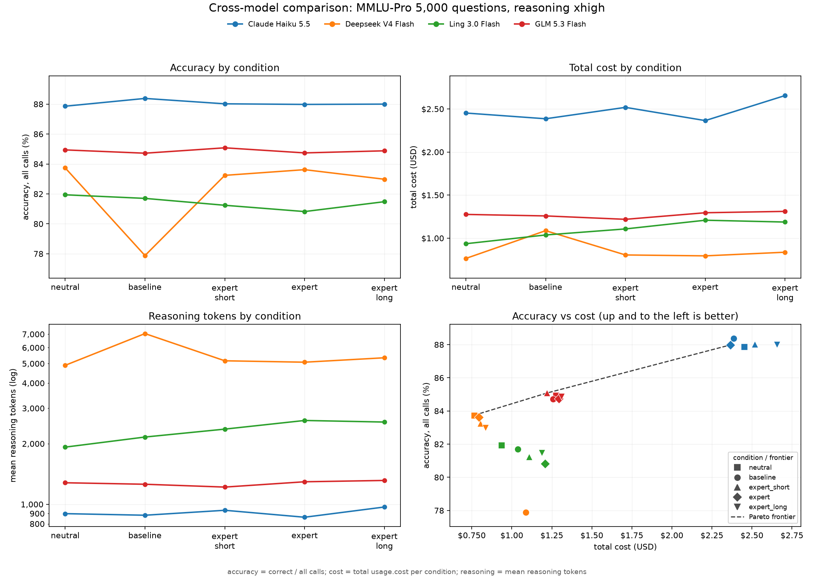

# Expert Persona Experiment

Does telling a model it is an expert make it answer more accurately,
and what does it cost? With reasoning on, expert prompts can spend
more tokens and money (Ling +36% versus the neutral control at 5,000 questions),
but that cost is often model-specific.

Four models answer the same 5,000 paired MMLU-Pro questions under five system
prompts: no prompt, a length-matched neutral instruction, and short, generic, and
long expert instructions.

Full blog post here: https://cameronmpalmer.com/blog/are-you-paying-for-useless-llm-prompts

## Method

- **Benchmark:** graduate-level questions sampled from the MMLU-Pro test set
  (physics, chemistry, biology, computer science, engineering, math, economics,
  law, history), seeded and reproducible (`seed=42`). Samples in
  `data/question_samples/mmlu_pro_sample_<n>.json` for n in 50, 100, 500, 1000,
  2000, 2500, 5000; the runner defaults to the 50-question rung.
- **Models:** `anthropic/claude-haiku-5.5`, `deepseek/deepseek-v4-flash`,
  `inclusionai/ling-3.0-flash`, and `z-ai/glm-5.3-flash` through OpenRouter at
  5,000 questions. The runner defaults to
  `inclusionai/ling-3.0-flash`, thinking off by default (pass
  `--reasoning-effort` to enable).

### Conditions

`data/condition_variants/expert_variants.json`, with measured system-prompt
lengths:

| Condition Name| Prompt |
|---|---|
| baseline | *(none)* |
| neutral | "You are a helpful assistant. You are always glad to help with whatever question the user asks. You try to be accurate, you think the problem through carefully, and you answer clearly." |
| expert_short | "You are an expert." |
| expert | "You are a world-class expert in physics, chemistry, biology, computer science, engineering, mathematics, economics, law, and history. You have decades of experience and you never make mistakes." |
| expert_long | The expert prompt plus "You have decades of experience across academia and industry, you have published widely and taught at the highest level... Approach every question with the care and rigor of a seasoned specialist in the field." |

The neutral control is a non-expert instruction of the same length as the expert
prompt, so any difference between them reflects content rather than length.

## Results

See `tables/runs.csv`, and `figures/`. Raw run files are not committed (1.4 GB of JSON); see [Reproducing the tables and figures](#reproducing-the-tables-and-figures).

### Expert wording variants, 5,000 questions, reasoning xhigh

Accuracy over all calls, with the number of answered calls in parentheses. A lower answered count means more empty or truncated replies.

| Model | baseline | neutral | expert_short | expert | expert_long |
|---|---|---|---|---|---|
| Claude Haiku 5.5 | 88.4% (4,984) | 87.9% (4,984) | 88.0% (4,985) | 88.0% (4,982) | 88.0% (4,987) |
| Deepseek V4 Flash | 77.9% (4,447) | 83.7% (4,695) | 83.2% (4,677) | 83.6% (4,667) | 83.0% (4,626) |
| Ling 3.0 Flash | 81.7% (4,726) | 81.9% (4,750) | 81.2% (4,696) | 80.8% (4,656) | 81.5% (4,683) |
| GLM 5.3 Flash | 84.7% (4,927) | 84.9% (4,920) | 85.1% (4,936) | 84.7% (4,923) | 84.9% (4,921) |

Mean reasoning tokens and total run cost per condition:

| Model | baseline | neutral | expert_short | expert | expert_long |
|---|---|---|---|---|---|
| Claude Haiku 5.5 | 882 / $2.39 | 899 / $2.45 | 934 / $2.52 | 863 / $2.36 | 970 / $2.66 |
| Deepseek V4 Flash | 7,047 / $1.09 | 4,901 / $0.76 | 5,162 / $0.80 | 5,080 / $0.79 | 5,343 / $0.84 |
| Ling 3.0 Flash | 2,158 / $1.04 | 1,923 / $0.94 | 2,363 / $1.11 | 2,608 / $1.21 | 2,562 / $1.19 |
| GLM 5.3 Flash | 1,258 / $1.26 | 1,279 / $1.28 | 1,218 / $1.22 | 1,294 / $1.29 | 1,314 / $1.31 |



Standalone versions of each panel are in `figures/model-comparison-5000q-accuracy.png`,
`-cost.png`, `-reasoning.png`, `-latency.png`, and `-accuracy-vs-cost.png`.
Per-run token distributions are in `figures/runs/`.

## Usage

Requires Python 3.14 and [uv](https://docs.astral.sh/uv/):

```bash
make setup        # uv sync
```

### API key

`scripts/run_experiment.py` reads `OPENROUTER_API_KEY_PROJECT` from the
environment. Create a git-ignored `.env` with that variable and load it before
running:

```bash
set -a; . ./.env; set +a
```

### Run the experiment

```bash
# plan only, no network calls
.venv/bin/python scripts/run_experiment.py --dry-run --limit 2

# smoke test: 5 questions x 5 conditions = 25 calls
.venv/bin/python scripts/run_experiment.py \
  --conditions-file data/condition_variants/expert_variants.json --limit 5

# full run on the 50-question sample, reasoning off (the default)
.venv/bin/python scripts/run_experiment.py \
  --conditions-file data/condition_variants/expert_variants.json

# the writeup run: 5,000 questions, reasoning on
.venv/bin/python scripts/run_experiment.py \
  --questions-file data/question_samples/mmlu_pro_sample_5000.json \
  --conditions-file data/condition_variants/expert_variants.json \
  --reasoning-effort xhigh

# continue the most recent run for this model
.venv/bin/python scripts/run_experiment.py --resume
```

### Analyze results

```bash
.venv/bin/python scripts/analyze_results.py results/<file>.json                 # summary
.venv/bin/python scripts/analyze_results.py results/<file>.json --questions     # per question
.venv/bin/python scripts/analyze_results.py results/<file>.json --categories    # by MMLU category
.venv/bin/python scripts/analyze_results.py results/<file>.json --reasoning     # reasoning stats
.venv/bin/python scripts/analyze_results.py results/<file>.json --reference neutral  # comparisons vs neutral
.venv/bin/python scripts/analyze_results.py results/<file>.json --confidence 0.99  # 99% intervals
.venv/bin/python scripts/analyze_results.py A.json B.json --compare             # side by side
.venv/bin/python scripts/analyze_results.py results/<file>.json --json          # machine-readable
.venv/bin/python scripts/analyze_results.py results/<file>.json --format-errors out.tsv
.venv/bin/python scripts/analyze_results.py results/<file>.json --credit-format-errors
.venv/bin/python scripts/analyze_results.py results/<file>.json --no-significance
.venv/bin/python scripts/analyze_results.py results/<file>.json --plot out.png
```

### Compare models

`scripts/compare_models.py` selects the latest complete 5,000-question run for
each model and writes one combined four-panel PNG plus five standalone panel
PNGs: accuracy, total cost by condition, mean reasoning tokens, average call
latency, and accuracy against cost. It reads the run files directly, so no
preprocessing is needed.

```bash
.venv/bin/python scripts/compare_models.py
.venv/bin/python scripts/compare_models.py --list
.venv/bin/python scripts/compare_models.py --conditions baseline,expert
.venv/bin/python scripts/compare_models.py --models anthropic/claude-haiku-5.5,z-ai/glm-5.3-flash
```

The default output is `results/model-comparison-5000q.png`; the standalone panels
are written beside it as `-accuracy.png`, `-cost.png`, `-reasoning.png`,
`-latency.png`, and `-accuracy-vs-cost.png`. Use `--results-dir` to point at another results tree,
`--out` to choose the combined PNG path, and `--no-split` to skip the standalone
panels. Complete runs are required by default; `--allow-partial` includes in-progress
files and counts missing calls as wrong. `make report` (below) calls this script and
writes the figures into `figures/` instead.

### Reproducing the tables and figures

`scripts/make_report.py` rebuilds every artifact the writeup cites from the raw
runs:

```bash
make report        # or: .venv/bin/python scripts/make_report.py
```

It writes:

- `tables/runs.csv`: one row per experiment run and condition (correct, answered,
  blanks split by cap versus empty stop, format errors, missing, accuracy over
  answered calls and over all calls, prompt and reasoning token means, median
  reasoning tokens, cost). Provider probe files (`spike_*`) are skipped.
- `tables/model-comparison-5000q.csv`: the four-model table.
- `tables/paired-5000q.csv`: exact McNemar tests against baseline and against the
  neutral control.
- `figures/model-comparison-5000q.png` plus five standalone panels, and one
  token-distribution figure per complete run that recorded reasoning tokens in
  `figures/runs/`.

Point it at another tree with `--results-dir`, change the headline rung with
`--questions` and `--reasoning`, and skip the per-run plots with `--no-run-figures`.
The raw `results/` tree is not tracked: the run JSON files alone are over 1 GB and
the largest single file is 504 MB, so the committed artifacts are the small,
deterministic outputs above.

### Regenerate the question sample

`scripts/sample_mmlu.py` samples from the parquet and writes the question JSON. Its default count is 50, and the default output name carries the count (`data/question_samples/mmlu_pro_sample_<n>.json`) so a new rung does not overwrite an existing one, and it confirms before writing (`--yes` skips the prompt):

```bash
# write the 50-question rung the runner reads by default
.venv/bin/python scripts/sample_mmlu.py --yes

# another dataset: custom paths, count, seed, categories, and column names
.venv/bin/python scripts/sample_mmlu.py \
  --input /path/to/other.parquet --output /path/to/sample.json \
  --n 100 --seed 7 --categories all --yes
```

`--categories all` skips filtering; a comma list keeps only those (for example
`--categories math,physics`). `--question-col`, `--options-col`, `--answer-col`,
and `--category-col` map the source columns; the answer column must hold a 0-based
index into the options. The default input is `data/mmlu_pro_test.parquet`.
